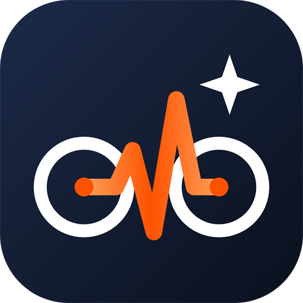

# Ride Partner — AI cycling coach (Android)

Offline-first cycling coach for one rider. Syncs rides from Strava, measures heart-rate zones, climbing VAM,
aerobic decoupling and training load, and uses Google Gemini as a personal coach.



## What's in the app (v3)
| Tab | What it does |
|-----|--------------|
| **Rides** | Week summary with goals, streak and form; today's planned session; search & filters; pull to sync; rides grouped by month with zone strip |
| **Ride detail** | Route map coloured by HR zone, key stats, feel + RPE + private note, zone time, VAM, decoupling, load, best efforts (NP/IF/TSS with a power meter), comparison with prior rides of the same intent, stream chart, AI debrief and chat (streaming, screenshots), shareable ride card |
| **Trends** | Fitness / Fatigue / Form (CTL / ATL / TSB from TRIMP), training calendar, weekly volume, best efforts (all time vs 6 weeks), ride-by-ride progression, AI season audit |
| **Compare** | Two or three rides side by side + AI comparison |
| **Coach** | **Aether** (season coach — full context, can change your plan and targets after you approve), your training plan (weekly template + day changes + weekly targets, done/missed tracking, AI adapt), every ride thread |
| **Reports** | 7d / 30d / 1y / all-time KPIs vs previous period, zone strain, all-time records, AI review, A4 PDF export |
| **Profile** | Athlete, **Samsung Health via Health Connect** (sleep, resting HR, HRV, weight, steps, VO2max), **coach skills** (built-in + import from GitHub), default weekly targets, weight log, training phases, HR zones + FTP, Strava, **AI providers** (free + paid, fallback) and **monthly spend cap**, theme, auto-sync, haptics, backups, restore points, Classic (v2) rollback, diagnostics, demo rides |

## AI providers
| Provider | Cost | Notes |
|----------|------|-------|
| Google Gemini | Free tier | Default. Key: aistudio.google.com |
| Groq | Free tier | Very fast, daily limits |
| OpenRouter | Free `:free` models, paid others | Prices read automatically |
| Mistral | Free mode | Account limits |
| Anthropic Claude | Paid | Prices filled in automatically |
| OpenAI / DeepSeek | Paid | Enter prices for spend tracking |
| Custom | Your choice | Any OpenAI-compatible URL, e.g. local Ollama |

Paid providers stop being used once the monthly cap is reached; free providers are never counted.

## Project layout
```
www/                  the app (no build step — plain HTML/CSS/JS)
  index.html          v3 app shell
  classic.html        previous v2 app, kept as the rollback version
  css/app.css         design system (light default + dark theme)
  fonts/              Barlow (SIL OFL)
  img/logo.svg        logo
  js/recovery.js      crash guard & recovery screen
  js/vendor/          Dexie, Plotly (basic), jsPDF, autotable — bundled for offline use
  js/app/             util, ui, db, physio, athlete, strava, ai, charts, demo, main
  js/app/views/       rides, detail, trends, compare, coach, reports, profile
android-res/          launcher icons (adaptive + themed + legacy PNG) and splash
assets/               logo sources and 512/1024 px PNGs
scripts/
  build-apk.ps1       local one-command build → C:\dev\releases
  patch-android.js    applies name, deep link, icons, splash, version to android/
  render-icons.ps1    regenerates PNG icons from the SVGs
docs/                 review, plan, changelog, rollback and build guides
```

## Docs
- [docs/REVIEW.md](docs/REVIEW.md) — everything that was wrong in v2 and how it was fixed
- [docs/CHANGELOG.md](docs/CHANGELOG.md) — what changed in v3
- [docs/ROLLBACK.md](docs/ROLLBACK.md) — how to undo a bad update (data and version)
- [docs/BUILD.md](docs/BUILD.md) — building the APK locally and on GitHub
- [docs/PLAN.md](docs/PLAN.md) — architecture, decisions and progress log
